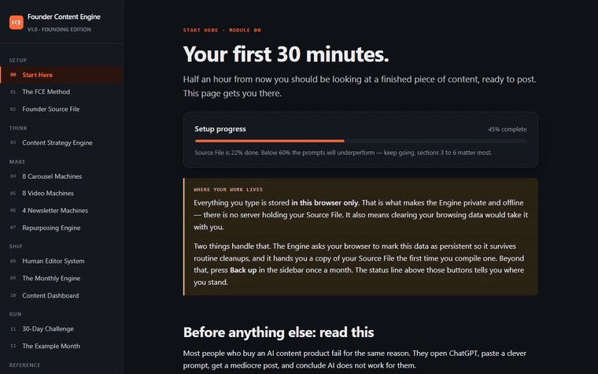

<div align="center">

# Founder Content Engine

**An AI content operating system for founders, consultants, coaches and agency owners.**

One file. Fifteen modules, twenty content machines, twenty-nine prompts that carry your real context instead of generating generic output.

[](https://mohworldent.gumroad.com/l/engine)
[](https://mohworldent.github.io/founder-content-engine/)
[](#)

[**Get the Engine — $49**](https://mohworldent.gumroad.com/l/engine) &nbsp;·&nbsp; [**Free: the 7-Point Human Test**](https://mohworldent.github.io/founder-content-engine/the-7-point-human-test.pdf) &nbsp;·&nbsp; [Live site](https://mohworldent.github.io/founder-content-engine/)

</div>



---

## Everything worth publishing this year is already in your head

Six years of client work. Three hundred sales calls. The mistake you've watched forty businesses make. The opinion half your industry would argue with.

None of it is on your feed — so you open an AI chat, ask for post ideas, and get thirty topics that could have been written for anyone in your industry.

**No prompt fixes that, because the model was never told a single thing about you.**

Founder Content Engine is built around the fix: teach it who you are once, and every workflow after that carries your business, your voice, your proof and your point of view into every request.

## What's inside

| Module | What it gives you |
|---|---|
| **Founder Source File** | 12 sections that extract your expertise, point of view, stories, proof, voice and anti-voice — completed once, reused forever |
| **Content Strategy Engine** | Pillars, territories, a 12-angle matrix, and an Idea Quality Score that kills weak ideas before they cost you a production cycle |
| **8 Carousel Machines** | Slide-by-slide LinkedIn/Instagram carousel structures, each with a worked example and the right CTA |
| **8 Video Machines** | Hook, script, B-roll list, on-screen text and shot list for short-form and talking-head video |
| **4 Newsletter Machines** | A rotation you can sustain for two years without dreading Thursday |
| **Repurposing Engine** | One approved idea into eleven distribution assets, including the sales asset almost nobody builds |
| **Human Editor System** | The De-Slop pass, the AI tell-list, and the 7-Point Human Test — the module that decides whether content builds a business or joins the pile |
| **Monthly Engine + Dashboard** | A four-week operating rhythm and a live pipeline board, CSV-exportable |
| **29 workflow prompts** | Not five hundred. Twenty-nine that run in sequence, each auto-injecting your Source File |
| **Worked example** | The full system run on two real businesses, honest numbers included — the post that got 11,000 views and produced nothing, and the one with 1,900 views that produced every lead |

Built for consultants, coaches, agency owners, B2B and SaaS founders, and independent experts — anyone whose knowledge *is* the product. Not built for anyone who wants content written entirely for them with no input, or who is chasing virality as the goal.

## What's in this repository

This repo hosts the **public site only** — the landing page, the demo video, and the free lead magnet (the 7-Point Human Test PDF). It is a static site: one HTML file, no build step, no framework, deployed straight to GitHub Pages.

The product itself — the offline content-engine application, 220KB, runs entirely in your browser — is not in this repo. It ships through Gumroad so buyers get a single downloadable file with no dependency on this repo staying online.

```
site/
├── index.html                    the public sales page + email capture
├── demo.mp4 / demo.gif           a 39-second walkthrough of the real product
├── the-7-point-human-test.pdf    the free lead magnet
└── og-image.png, sitemap.xml…    metadata for search and social previews
```

Everything here — the sales copy, the demo, the PDF, and the site itself — was generated by a small Python pipeline (`build.py → package.py → demo.py → deploy_site.py`) that drives a headless browser and ffmpeg. No manual screenshotting, no hand-written PDF. Details in [DEPLOY.md](DEPLOY.md).

## The one rule the product teaches

> AI starts *after* your thinking begins.

You supply the perspective, the experience, and the judgment. AI supplies research, structure, drafting speed and multiplication. Reverse that order and you get content that sounds like it came from any founder in your industry — because it did.

## Get it

- **[Buy Founder Content Engine — $49](https://mohworldent.gumroad.com/l/engine)** — lifetime access to v1, one payment, no subscription
- **[Download the 7-Point Human Test — free](https://mohworldent.github.io/founder-content-engine/the-7-point-human-test.pdf)** — the same publish gate used inside the product

---

<div align="center" style="color:#888">

Founder Content Engine · <a href="https://mohworldent.gumroad.com/l/engine">Gumroad</a> · <a href="https://mohworldent.github.io/founder-content-engine/">Live site</a>

</div>
